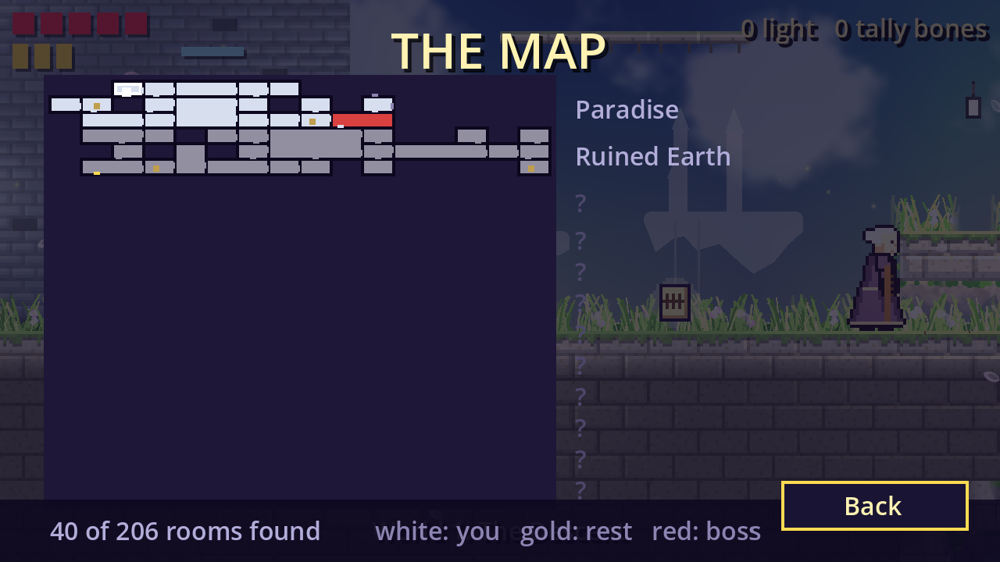
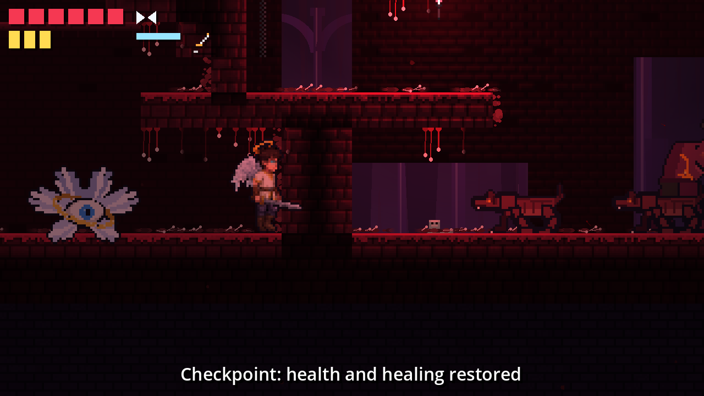
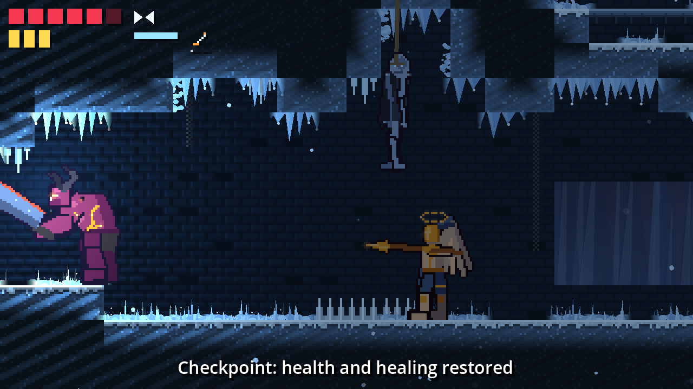

# Descender

A side-view metroidvania built in Godot 4: a man with half-finished angel
powers fights his way down from Heaven, through Purgatory and the nine
circles of Hell, to rescue his brother.

This repository holds the first playable prototype: the whole world as one
connected map, exported from the map tool, with the hero, movement, melee
combat, enemies, checkpoints, limited healing and the first scenes of the
story, behind a title screen with three save slots.

## Running it

1. Install [Godot 4.7](https://godotengine.org/download) (standard build, no
   .NET needed).
2. Open `project.godot` in the editor and press **F5**, or run
   `godot --path .` from this folder. A fresh clone needs one import first,
   which opening the editor does by itself; without the editor, run
   `godot --headless --import --path .` once.

To jump straight into a level while testing, run the level scene with its
id: `godot --path . scenes/main.tscn -- --level=world_1`. The ids are
listed in `scripts/levels.gd`. Two more arguments help with playtesting the
deep regions: `--checkpoint=<n>` starts the hero rested at the level's nth
checkpoint (counted from the top, as the HUD names them) and
`--abilities=all` unlocks every ability and opens the ability seals, so
`godot --path . scenes/main.tscn -- --level=world_1 --checkpoint=12 --abilities=all`
drops a fully able hero in the lower circles. They only apply to a game
started without a save.

The game renders at **320x180** and scales up by whole numbers, so the
window is 1280x720 by default.

## Controls

| Action  | Keyboard            | Gamepad        |
| ------- | ------------------- | -------------- |
| Move    | A / D or arrows     | Left stick / D-pad |
| Drop    | S or Down, with jump | Stick or D-pad down, with A |
| Jump    | Space, W or Up      | A              |
| Attack  | J or X              | X              |
| Dash    | K or Shift          | RB or B        |
| Cast    | L or C              | RT             |
| Heal    | H                   | Y              |
| Talk    | E                   | LB             |
| Menu pages | Q / E            | LB / RB        |
| Pause   | Esc                 | Start          |
| Restart | R                   |                |

The title screen is driven with the arrow keys, the d-pad or the left
stick, Space or A to choose and Esc or B to go back; every menu works
the same way with a gamepad alone.

**Button prompts** follow whatever the player last touched: press a key
and the hints along the bottom of the menus, the HUD messages and the
talk prompt over an NPC name keys; press a gamepad button and they turn
into button icons, in the Xbox layout or the PlayStation one (Cross,
Circle, Square, Triangle, L1/R1, L2/R2) depending on the pad's name. The
switch is instant, in both directions, mid-menu or mid-fight. The
**Pad prompts** setting on the Game page pins one layout (Auto, Xbox,
PlayStation) for a pad that reports a name the game does not recognise.
The prompts come from the `Prompts` autoload (`scripts/prompts.gd`): a
hint is written as text with `{action}` tokens, such as
`"{ui_accept} choose   {ui_cancel} back"`, and a `PromptLabel`
(`scripts/ui/prompt_label.gd`) draws it and redraws it on every switch,
so new screens get prompts by dropping one in. The icons are drawn by
`tools/gen_prompts.py` into `assets/ui/prompts/`.

**New Game** picks a slot (an occupied
one asks to be pressed twice before it is overwritten), **Continue** resumes
the most recent save (the line along the bottom says which, while the
button is focused) and **Load Game** picks any slot. A new game then picks
a **difficulty**, kept with the save: Easy gives the hero an extra heart
and an extra healing charge, Hard makes every blow on him land twice as
hard, and Normal is the descent as it was meant. The load picker's
**Delete a save** button turns it into a delete picker, where a slot asks
to be pressed twice before it is cleared. **Credits** lists who made the
game (the lines are `CREDITS` in `scripts/ui/title.gd`), and the version
in the corner is the project's `application/config/version`.

**Settings**, on the title screen and in the pause menu, has four pages.
**Audio** has the master, music and sound effect volumes and a toggle for
the blips dialogue ticks with. **Display** has fullscreen (on by default:
the game starts full screen, filling the display at the screen's own
aspect; a window scales the 16:9 view by whole numbers instead), the
window size, v-sync and the screen shake. **Controls** has the bindings: pick an
action, press the new key (a key taken from another action is moved, not
shared) or Esc to keep the old one; the **Bindings for** button flips the
list between the keyboard and the gamepad, which are rebound separately
(the list opens on the device in use). A binding waits five seconds for
the new key or button, so a player holding only a pad backs out by waiting.
**Game** has the dialogue text speed (slow to instant), and toggles for
the white flash and the blink of stopped time on a hit and for gamepad
rumble, for anyone they bother, and **Pad prompts**, which picks the
gamepad layout the hints show (see above). Settings live in `user://settings.cfg`.

Pausing opens a menu to resume, restart at the last checkpoint (what R
does), save, open the map, read the promises (the quest log), open the
pack (the inventory, below), open the settings or quit
to the title, which asks to be pressed twice since whatever happened
after the last save goes with it. A line under the heading says which
slot the game is in and how long it has been played. Saving there records
the last checkpoint, which is where the save will resume.

**The Map** draws the rooms of the world the hero has stood in, on the
room grid of the export, with the whole world on one page: a room is
found the first time he walks into it (flag `room:<id>`, so the save
keeps it), the region names down the side appear as he reaches them, and
the line at the bottom counts the rooms found. A blinking white mark is
the hero, a gold mark a checkpoint (bright for the one he will come back
to), a red room a boss not yet beaten (dark once he is), a gap in a wall
a door he has been through, a grey tick on a wall a way he has not taken
yet, and a gold tick a seal that still holds. Secret passages are only
drawn once both their rooms are known.



The map is also where the hero **travels**. Standing at the checkpoint he
last rested at, he can be carried by the angels' system to any other
checkpoint he has rested at (flag `rested:<n>`, kept with the save): on
the map page, left and right pick one, it blinks in a ring, the footer
names it with its region, and Space (or the talk key) goes. The screen
goes black, he arrives rested with the enemies rebuilt, and the game
saves there. Away from a checkpoint, or mid-fight or mid-talk, the map is
only a map.

The top left of the screen shows hearts, healing charges, the angel
abilities unlocked so far and a small bar that fills as the dash comes
back; the top right shows the purse (light and tally bones, below). Jump height depends on how long the button is held. Dashing gives a few
invulnerability frames. Picking up the feather unlocks the **wings**: press
jump again in the air for a second, slightly lower jump. The second feather,
by the checkpoint, unlocks the **light dash**: the dash goes further and
passes through walls of angel light, which block everyone else. Deeper
down, the **wall grip** feather lets the hero cling to a wall by holding
towards it, sliding slowly, and spring away from it with jump (which also
gives the wings and the dash back); the **glide** feather lets him press
jump again while falling, once the wings' jump is spent, and hold it to
float down. **Holy Light** throws a bolt of light from the hand with the
cast key: it flies straight, hurts the first enemy it meets and breaks on
the world. **Smite** is down and attack in the air: the hero slams to the
ground, through any ledge in the way, and the landing hurts everything
around his feet for two. Abilities stay unlocked after death. Healing has three charges that come back when the
hero rests at a checkpoint, which is also where he respawns after dying.
Resting at a checkpoint also saves the game: the level, the checkpoint, the
unlocked abilities, the story flags and the time played go to the slot the
game was started from, as JSON under `user://saves/`. Loading puts the hero back at that
checkpoint, rested, with the feathers he already took gone from the level.
Restarting with R does the same from the progress so far.

Thin ledges can be jumped up through from below, and the hero drops
through one by holding down and pressing jump. Standing still and holding
down on its own peeks below: after a moment the view pans down a few
tiles, so a drop can be looked at before it is taken, and comes back when
the button is let go. A hard landing raises a puff of dust at his feet.

The map's **locked doors** are seals of angel light across the shafts and
doorways between rooms. A seal lifted by an ability breaks the moment the
hero learns it; one held by a boss breaks when that boss dies. Touching a
seal says what it wants. Every boss room with a profile holds a **boss**:
walking in seals the room's doors, plays the boss's lines and shows its
health bar at the bottom of the screen. The boss walks at the hero, swings
with a wide telegraphed sweep and charges across the room when he keeps
away. Each body has a move of its own on top: the brutes raise their arms
and slam the ground, sending a tall shockwave along the floor; the angels
leap and throw three bolts of light down in a fan; the imp kings call two
imps to them when the fight turns. At half health it roars, flashes and
swells for a moment, then quickens and leaps after every charge. The
last three turn twice: below a quarter of their health the Champion of
the Red Arena rampages (his charges bounce off the walls and come back,
and his slam sends a wave each way), the False King calls his court (two
imps that pounce) and throws hellfire from where he stands, and the
Lowest fights with the hero's own light: a bolt of Holy Light from the
hand at range, and a Smite that goes straight up and comes down on the
hero's head with a wave each way. Killing it
sets a story flag (`boss:<id>`), saves the game, opens the doors it held
and plays its last lines; a dead boss stays dead in the save. Every boss
room has a profile now (the strips of the guard, imp, brute or hero, scaled
and tinted, with their own numbers): the Seraph Warden, the Penitent, the
Limbo Lord, the Keeper of the Palace, the Bloated One, the Warden of the
Vault, Gorrow the Fury, the Cursed Bishop, the Champion of the Red Arena,
the False King and, at the bottom, the Lowest. Beating Gorrow in Wrath is
the story's reveal: it sets the `reveal` flag the survivors on Earth react
to, and Gorrow no longer waits in Lust afterwards (an NPC placement's
`unless` flag).

Hidden in the levels are **permanent upgrades**: a Kept Light adds a heart
and a Vial of the Basin adds a healing charge, for the rest of the save.
Four Kept Lights lie in the secret rooms of Paradise, Purgatory, Gluttony
and Fraud, and the promises give two more hearts and two vials, so a
hero who finds everything ends with ten hearts. Each
reads like a relic when it is taken, and a taken one stays gone. The sword
is hardened at **Old Pell's forge** on Earth: his third talk uses his own
stock of church iron (one more damage), and a bar of Church Iron found in
Heresy, carried back to him, adds another. **Vael the Bargainer** in Greed
trades once the hero knows the name below: a memory (flag `sold_winter`)
for the clock key (`item:clock_key`); a dialogue entry's `sets` may be a
list of flags for trades like these. Both of them also keep a stall, see
the economy below. There are
also **power-ups** lying in rooms: a Halo turns the next hit aside, a Lit
Blade makes the sword hit harder and Zeal makes the hero run and dash faster,
each for twenty seconds. Three lie in Paradise and five in the secret
rooms below (Lust, Wrath, Heresy, Fraud, Treachery), so every secret
passage pays out a Smite. Power-ups are lost on death and come back with the
enemies. The design, with how many of each the whole game needs and where
they go, is in [`docs/design/upgrades.md`](docs/design/upgrades.md). Reaching a goal
gate fades out, saves, and starts the next level with the abilities so far;
the gate of the last level ends the prototype. The world has no gate yet:
it is one map from top to bottom.
Spikes cost one heart and put the hero back on the last solid ground.
Imps, angel guards and the rest of the walkers swing when the hero stands close: they stop, glow
orange while winding up, then strike in front of them and pause to recover.
Hitting one during the wind-up cancels the swing (except a brute's: its
armour keeps the blow from staggering it, and a hit only pushes it half as
far). A hit enemy flinches and shows its health for a moment. A killed one
stops time for a blink and dies in its own way: the imp crumples, the guard
goes down on a knee and tips forward, the brute pitches onto its face and
shakes the ground, the watcher's eye shuts and its ring falls apart. The
body lies there a moment in a puff of dust (or light, for the angels) and
fades, and sometimes leaves a mote of light that restores a heart (angel
guards always do). A brute always leaves a Halo instead, and an imp or a
guard now and then a Lit Blade or Zeal; a dropped power-up goes with the
motes when the enemies come back. Every kill also leaks **light**, the
common currency, in a cluster that flies to the hero once he is near,
and now and then a **tally bone** or a Basin Flask. The enemy strips are drawn by
`tools/enemy_sprites/export.py` from the art thread's rigs.

The **economy**: light is kept through death and load and buys blades and
coats at **Old Pell's forge**, tally bones (three from every boss, rarely
from an imp) buy charms and bottled power-ups from **Vael the Bargainer**
in Greed and Violence. Once a trader's unique lines are spent, each talk
plays a repeat line and opens his stall: Space buys, Esc leaves.
Every boss leaves one piece of **unique loot** once per save (the
Warden's Halo, the Glutton's Maw, the Champion's Plate, the False Crown
and so on), laid back down by its room until it is taken. The hero
wears one sword, one armour and one charm at a time, from **The Pack**
page of the pause menu, which also lists his consumables (a Basin Flask
puts a healing charge back; a Halo Shard, Choir Oil or Draught of Zeal
is a power-up in a bottle) and the kept things of the story. Worn pieces
change his damage, reach and swing, the guard that takes hearts off a
hit, his maximums, his feet and his drops; the whole design, with every
item and price, is in [`docs/design/economy.md`](docs/design/economy.md).
The pack goes into the save under `inventory`.

Every kill also gives **experience**. Enough of it is a **level**, shown
under the purse with a bar towards the next, and every level is a skill
point. Touching a checkpoint rests as before; pressing the talk key at one
**makes camp**: a menu over the paused game with the pack, the **skills**
(Vigour, Edge, Swift Feet and seven more, a few ranks each, some opening
only at a level), fast travel to another checkpoint he has rested at (the same map
picker the pause menu has) and the save. Experience and
skills go into the save under `skills`; the design, with the curve and
every skill, is in [`docs/design/progression.md`](docs/design/progression.md).

Below Limbo the enemies pick up habits, one per placement (`behaviour` in
`placements.json`): a **chaser** walks at the hero once he is near and
level, stopping at the end of its ledge; an **ambusher** stands as if idle
until he is close, then springs with a quick swing, a red mark over its
head the only warning; a **pouncer** (imps) crouches and leaps at a hero a
few tiles away, claws out; a **hurler** (imps) keeps its distance and
throws a bolt of hellfire, backing off when he comes close; a **slammer**
(brutes) raises its arms and strikes the ground, sending a shockwave along
the floor that has to be jumped. Watchers that **dive** keep above the
hero instead of drifting at him, stop, turn the eye red, and drop through
him before climbing back for another pass. The mix thickens on the way
down: chasers from Lust, ambushers from Gluttony, hurlers from Greed,
slammers and pouncers from Wrath, divers from Heresy, everything in
Violence and Treachery. Each region keeps bodies of its own, too: Heaven
is angels only (guards and watchers), Purgatory is the border where both
sides stand, and every circle below the hub has one demon found nowhere
else on top of the imps, brutes and **shades** (the demons' drifting
flyer, from Limbo down) found everywhere: the **siren** of Lust (a
velvet-winged flyer that comes fast), the **slug** of Gluttony (a bloated
armoured maw that lies in wait and bites), the **hoarder** of Greed (a
hunched demon that throws from its sack and leaks the most light), the
brutes' slams in Wrath, the **burned** of Heresy (sent-down angels, the
guard's bones charred) and the two below. The roster, with every body's
numbers and where it stands, is in
[`docs/design/enemies.md`](docs/design/enemies.md). The
**hound** (Violence) is a lean four-legged demon that hunts in pairs,
sees the hero from far off, runs at him faster than he walks and springs
flat at him from a few tiles away, jaws open (`lunge`); and the **hanged
thing** (Treachery) is a frozen traitor on a rope under the ceiling,
swaying, that creaks and lets go when the hero walks beneath it, drops on
him for two hearts, lies where it lands for a moment (when it can be hit)
and is hauled back up for the next pass. Killed, it falls for good.





The story is told in text boxes. Standing next to someone, or to a relic,
shows the talk key above them; pressing it opens a box at the bottom of the
screen, and the same key (or jump) turns the page. The text types out with
a soft blip, pitched by who is speaking, and rests a moment on full stops
and commas; a press shows the whole page at once. The speaker's name takes
their colour (the Voice is the Choir's pale light, Tobiah and the demons the
red of the deep circles), and a line nobody speaks, a stage note or a
relic's description, is grey and silent. The hero stands still and
cannot be hurt while a box is open. People say different things once the
hero has heard their first lines, relics are gone once read, and a few spots
in the level speak on their own the first time the hero walks through. What
he has seen is kept as story flags in the save. Everyone has a few unique
conversations, in order, some of them unlocked by what the hero has found;
once those are used up they rotate through a handful of repeat lines, one
per talk. The script for the whole game, with the lines that are in the
levels and the ones that are not yet, is in
[`docs/story/script.md`](docs/story/script.md).

Below Paradise the hero lands in Ruined Earth, the hub region under the
hole in the sky, with its own ambient tint and sound, where four survivors
(Old Pell, Hanne, Corporal Dace and Sister Ava) and three relics tell what
the war looks like from the ground. The passage at its right end leads on
to Purgatory.

Below the hub the world is peopled: imps, the **brute** (slow, eight
hits, a two-heart swing) and each circle's own demons stand through the
nine circles at a rising density (Fraud's army rests instead), with the
angels kept to Heaven and Purgatory, all listed in `placements.json`. Fallen imps in Limbo and Lust shout a
line from the script as they wind up. The story goes on down there too: the names in
the Purgatory shaft, the Ferryman (who hands over the clock's hand), the
imp's tally bone in Limbo, Gorrow waiting by the seal in Lust, the wall in
Gluttony that says DON'T FOLLOW, and Vael the Bargainer in Greed. In
Heresy the hero sees the Basin's pipes, meets Tobiah's messenger (a
sent-down angel Tobiah speaks through) and can find the Choir's tablet and
the clock weight; in Violence Vael waits again, with the pipe section and
the clock chain below him, and Thorne, the lad in the red scarf from
Dace's letter, stands by the checkpoint, half turned. Reading the letter
and hearing Dace out starts the **red scarf** side quest (flag
`quest:scarf`): Thorne asks whether the barricade holds and whether Dace
sent the hero, and the answer is a choice that changes what each of them
says afterwards. Either way he hands over the scarf (`item:scarf`), and
Dace, back on Earth, takes it and gives Thorne's flask, one more healing
charge (a dialogue entry's `gives` names an upgrade kind; the gift is a
flag, `upgrade:<kind>:gift:<entry>`, so it stays given in the save). The
survivors also answer what the hero has seen below: the Warden's fall,
the pipes, the Wheel in writing and the resting army each unlock a line.
Three more promises are made on the way: **Hanne's drawings** (flag
`quest:drawings`, once she has shown her flag): bring her word of the
names in the shaft, the wall that says DON'T FOLLOW and the pipes, and
she draws each; after the reveal she draws Tobiah from Ansel's
description and the page keeps a heart. **Orla Pell** (`quest:wife`, after
the warrant): Pell names his wife, Mereth in the orchard remembers her
and what she said going in, and Pell, told, lifts the step and gives
what she kept back, a heart. **Ithuriel's song** (`quest:song`): the guard
asks what he is humming, the Ferryman knows (a cradle song the Basin
took), and Ithuriel, told, hands over his Warden's glass, a healing
charge. Mereth and Ithuriel are back up in Paradise, through the secret
passage from the hub, so the last two are climbs. The pause menu's
**Promises** page lists every quest the hero has taken on with its steps
ticked (`scripts/quests.gd` names the flags), kept ones last, and the HUD
says when a promise is made or kept. Fraud is the last camp: the army rests there
(`passive` enemies, which patrol and never swing), an imp offers a tally
bone, and the roster lies among them. At the bottom of Treachery the
Lowest speaks before the fight and after it, and the last line is a
choice (left and right pick, interact confirms): carry him or sit down.
Either ends the game. The clock in the Time Clock room, once all five
pieces are found, sends the hero back up to the start of the world
(`warp` on its entry), where the Gardener waits in the Warden's room for
the last fight and the third ending. A dialogue entry's `then` names the
entry that follows it, a line's `choices` list the options with their
`then`, and an enemy placement may name a boss profile as its `character`
and a flag it `requires` (read whenever the enemies spawn). A single line
inside an entry may carry `requires` and `unless` flags of its own: the
line is left out while they do not hold, so one conversation can say
different things to a hero who has seen different things.

## The world

The map is one world, 480 x 459 tiles, exported by the map tool as
`levels/world/world.json` with three tile sheets next to it: the diffuse
tiles, their normal map and the emissive glow. It is twelve regions stacked
top to bottom: Paradise, Ruined Earth, Purgatory and the nine circles from
Limbo to Treachery, each with an ambient colour that tints the screen while
the hero is in it. The export also holds the rooms, the doors between them
(some locked by an ability or a boss), 853 point lights and the markers.

Besides the tile layers the export may list **sprites**: decorations the
editor placed freely by the pixel instead of on the grid (big painted
pieces composed by eye). Each gives its atlas tiles row by row, the pixel
position of its top-left corner, its size in tiles and whether it is
mirrored, solid or glowing. `LevelBuilder._build_sprites` draws each as a
small `TileMapLayer` at that position above the tile layers (a glowing one
also gets an additive glow layer). A solid one collides with polygons traced
from its art: the opaque pixels, with strands thinner than a few level
pixels (grass tufts, hanging ivy) left out, so the hero stands on the stone
rather than on the tips of the grass; without the sheet's image the
export's `hit` box stands in. A sprite with a walkable shape drawn in the
editor (`shape`: polygons in level pixels from its top-left, unmirrored)
collides with exactly those polygons instead, mirrored with the sprite. The
traced outline is smoothed to within 1.5 level
pixels (`SPRITE_SMOOTH_PX`), so the half-pixel stairs the tracing makes of a
nearly flat painted top become gentle slopes, and the hero steps up any lip
of up to 4 pixels while walking (`Player.CORNER_CORRECTION`), so painted
ground never stops him like a wall.

The export also says how many pixels a tile has in the sheets, its **art
scale** (`art_tile`): 16 for pixel art, 64 for painted tiles, which makes a
30 x 17-tile room 1920 x 1088 pixels. The grid stays 16 level pixels a tile
whatever the art scale, so nothing about movement or collision changes; the
tile layers are drawn scaled by 16 / `art_tile`, and the window's whole-number
scaling puts 64-pixel art on screen pixel for pixel at 1280x720. The scale is
picked per map in the editor's header, and a map without it is pixel art as
before.

Two kinds of region art turn the grid into a painted shape, each read from
`assets/regions/<region key>/` (the region's name lowercased without its
number, so `1. Limbo` is `limbo`), and each optional per region:

Both are looked for next to the map's `world.json` first (`<map folder>/regions/<key>/`,
where the editor's export puts a region's **Sky backdrop** as a parallax set that covers the
view), then under `assets/regions/<key>/`.

- **Edges** (`edges.json`, built by `scripts/edge_decor.gd`): pieces drawn
  along the exposed sides of the solid terrain, tufts standing on the tops,
  growth hanging from the undersides and moss down the sides, overhanging
  the cells they belong to. The JSON lists the PNGs per side and the share
  of exposed cells that get one; the variant of a cell is fixed by its
  position.
- **Parallax** (`parallax.json`, drawn by `scripts/backdrop.gd`): painted
  layers behind the level, back to front, each repeated sideways and
  following the camera by a share of its movement (`scroll`), placed
  relative to the region's top edge (`y`); a `cover` layer is stretched
  over the view (the sky) and a `front` layer draws in front of the level
  (haze, wisps). A layer may also `drift` by itself (level pixels a second,
  `[x, y]`), `sway` sideways (`[amplitude, period]`), `blend` as `"add"` or
  `"screen"` (additive at a lower alpha), be `lit` by the level's lights
  (fog a torch brightens; other layers ignore them), `repeat_y` for a
  region taller than its art, and sit at a `depth` of 0 to 1 that pulls
  it towards the region's sky colour, the haze of distance (a layer
  without one gets half of what it does not follow the camera by). Painted
  sets are filtered with mipmaps; pixel art stays nearest. Crossing into
  a region cross-fades its set in over the last.
- **Particles** (`fx.json`, run by `scripts/region_fx.gd`): sprites drifting
  through the air of the region, petals, motes, embers, emitted across the
  view around the camera. An entry with a `preset` instead of a `texture`
  (`embers`, `dust`, `ash`, `leaves`, `rain`, `snow`, `birds`) draws its
  own sprite and may override the preset's fields; a region with no
  `fx.json` but a `particles` list of preset names in the export gets those.

The export's regions can carry their look too, each field optional:
`sky_top` and `sky_bottom` (the procedural sky's colours, else the level's
own, see `Levels.sky`), `cave` (flat dark streaks instead of clouds and
ridges), `light` (the rim light the sky throws on the tiles, else the sky
top), `ambient` (else one derived from the sky) and a `grade` of `tint`,
`contrast` and `saturation`. A top-level `descent: {"dark": 0..1}` darkens
the sky, the backdrop and the ambient evenly from the map's top to its
bottom. `scripts/region_look.gd` eases all of it over 2.5 s when the hero
crosses a region line.

The sky is `assets/shaders/sky.gdshader` on the `Sky` rect, the editor's
procedural sky ported: a gradient across the region's band keyed to the
camera, so the horizon rises as the hero falls, with ridges, a sea of
clouds and puffs drifting over time (stepped and dithered for pixel art,
smooth for painted maps). The lit tile layers wear
`assets/shaders/rim.gdshader`, which adds the region's light where a
tile's normal map faces up (`LevelBuilder.RIM_STRENGTH`, 0 turns it off).
Over the level and under the HUD, `scripts/post_fx.gd` draws
`assets/shaders/post.gdshader`: the region's grade and a soft vignette.
A `WorldEnvironment` with glow (and `rendering/viewport/hdr_2d` on) makes
the sky, the glow tiles and the lights bloom a little.

Each JSON says how many pixels per tile its PNGs are drawn at (`art_tile`),
so one set serves maps of any art scale. `tools/gen_region_art.py` (needs
Pillow and numpy) draws a region's whole set from code, and also its tile
textures for the map editor as `.lpx.json` files, written to
`../editor/art/<region>/` for the editor's `npm run upload-textures`.
Paradise has a full set: sky, two cloud layers, distant islands, light
rays, haze and wisps; grass and blossom fringes, floating-island
undersides and ivy; petals and gold motes; marble terrain, a pilastered
back wall, gold-rimmed ledges and the grass, vine, lantern and window
decorations. Replace any PNG with a painted one and keep the name, or edit
the JSON.

The regions below Paradise are drawn by the same script from a table
(`STYLES` in `tools/gen_region_art.py`): a dozen lines per region naming
its sky gradient, a far and a mid silhouette (a ruined skyline, a cavern's
teeth, a hall of pillars, ice spires, a wall of names, hanging cages or
veils), its fog and haze colours, what stands on its ledges (dead grass,
moss, slime, frost, cinders, bones) and hangs under them (roots,
stalactites, drips, icicles, chains, cloth), and what drifts through its
air (ash, snow, embers, motes, dust, flies, drops, smoke). Ruined Earth has
a dead sky with the hole in it, a broken skyline with a few lit windows,
dead grass and roots, ash and smoke; Purgatory grey mist, a wall of names
behind a hall of pillars, moss and drips, and slow motes. Each circle has
its own set: Limbo a blue cavern with dust and stalactites, Lust magenta
pillars and cages with silk tatters, Gluttony a green cave of slime and
flies, Greed a gold vault with chains and bones, Wrath lava glow under
spires with embers and smoke, Heresy a burning skyline with ash, Violence
a red cave of cages and drips, Fraud purple veils and motes, Treachery ice
spires, frost, icicles and snow. The parallax layers are anchored to the
region's height so they stay in view from its top to its bottom.

`scripts/level_builder.gd` builds it at boot: one `TileMapLayer` per layer
(Background, Decor, Terrain, Glow), collision merged from the terrain kinds
(solid, one-way ledge, hazard), a `PointLight2D` per light (without shadows,
which would need an occluder on every tile), and the markers: the start
puts the hero down, every save is a checkpoint, the ability markers for the
wings and the halo dash are feathers, every boss marker with a profile is
a `Boss` (the rest get an angel guard standing in), and every locked door
gets a seal (`scripts/door_lock.gd`). All six abilities have feathers now.
Every secret door of the export is a passage carved through the rock
between its two rooms and hidden behind that rock (`scripts/secret_wall.gd`):
a Smite landing on or beside it breaks it open for the rest of the save
(flag `secret:<door id>`), and the terrain tiles go with it. The gate
marker at the bottom of the hub is the `descent` trigger: the point of no
return, with a line from the Voice and an autosave (a dialogue entry's
`save` flag). The two shop markers stay data: the shops are Pell and Vael
themselves.

Everything else that stands in the world is listed in
`levels/world/placements.json`, which also names the dialogue file: an
`objects` list, each with a `type` and the tile cell `x`, `y` its feet are
on. The types are `npc`, `item` and `trigger` (story objects, with the
fields the dialogue system wants; an `npc` with a `shop` trades, see
`scripts/shops.gd`), `enemy` (`character`: a walker, flyer or hanger body,
see `docs/design/enemies.md`), `upgrade` (`heart`, `vial` or `iron`), `power`
(`halo`, `blade` or `zeal`) and `barrier` (a wall of light `height` cells
tall). Upgrades are numbered by their order in the list, so a save keeps
them straight as long as that order does not change.

To bring in a new export by hand, unzip it over `levels/world/` and keep
`placements.json`. The usual way is the live map below, which does the same
from the editor's Firebase project when the game starts. The tool's own `import_world.gd` is not used: the game
reads the JSON directly, so the map stays editable in the tool. This
settles the level pipeline question (#34): big maps come from the tool as
tile layers, and the hand-written ASCII levels of the first prototype are
gone.

### Running another map

**Maps menu.** The title screen's **Maps** button lists the levels in the game and every map the
editor published for it (**Publish for game** on a map's ⋯ menu on the editor's Maps page, or the
button in the map's header; `npm run publish-live -- --map "World 3"` from the editor repo does the
same). Choosing one downloads it into `user://maps/<map id>/` (world.json, the sheets, any region
backdrops and a `map.json` stamp of the published revision, so an unchanged map is not fetched
again), registers it with `Levels` as `map_<map id>` and makes it what **New Game** starts on (the button
says so, and the choice is kept in `user://map_choice.cfg` across runs until another map, or the
descent, is picked); saves made there reopen it. Downloaded maps stay listed without a connection, and after the editor unpublishes
them. `scripts/map_store.gd` (the `MapStore` autoload) does this, reading Firestore through
`scripts/firestore_rest.gd` like the live map sync; it needs only `live_map/project_id` and works
in exported builds too. Files the editor put in Cloud Storage (a head with `mediaBase`) stream
straight to disk, one request each; files published in Firestore pieces are read and joined.
`DESCENDER_FIRESTORE_HOST=http://127.0.0.1:8080` points both syncs at an emulator or a stand-in
server.

**Command line.** `--map=<map id or name>` downloads (if needed) and starts a published map, and
`--level=<path to a world.json>` starts an export in the project without listing it in
`scripts/levels.gd`:

    DESCENDER_LIVE_MAP=0 godot --path . scenes/main.tscn -- "--map=World 3" --no-live-map
    DESCENDER_LIVE_MAP=0 godot --path . scenes/main.tscn -- --level=res://levels/world3/world.json --no-live-map

both with the live-map sync off, so `levels/world` and the published live map are untouched. An
export in the project comes from the editor repo's
`npm run export-map -- --map "World 3" --out ../descender-godot/levels/world3` (its sky backdrops
land in `levels/world3/regions/<key>/`; `--regions ../descender-godot/assets/regions` also copies
them to the shared region folders). After new PNGs under `res://`, run
`godot --headless --import --path .` once (or open the editor).

### Live map

The map editor (`../editor`) keeps its maps in Firebase, and its Maps page
has a **Live map** picker. The editor publishes that map's Godot export
(`world.json` and the three tile sheets) into Firestore, where anyone may
read it, and republishes a few seconds after each save of the map while it
is open. When this project starts from the editor or `godot-mono --path .`,
the `LiveMap` autoload (`scripts/live_map.gd`) reads the small head
document over HTTPS and, if its revision differs from the one recorded in
`levels/world/live_map.json`, downloads the export and writes it over
`levels/world/`. Nobody needs an account, Node or the editor checkout: a
fresh clone runs and gets the live map. The title screen shows the outcome
along its bottom edge, and a game started while the download is still
running waits for it. `placements.json` is never touched, so a new map still
needs its placements to line up with its rooms. Exported builds never sync.

The Firebase project is the `live_map/project_id` setting in
`project.godot` and `live_map/enabled` turns the sync off for everyone. To
skip it for one run, pass `--no-live-map` after `--` or set the
`DESCENDER_LIVE_MAP` environment variable to `0`. Run from the project, the
game reads the tile sheets from the PNGs themselves rather than from Godot's
imported copies, since only the editor re-imports a changed PNG.

`levels/world/live_map.json` records what was pulled and is gitignored. The
pulled `world.json` and sheets are ordinary tracked files: commit them when
the live map is meant to ship.

## Layout

| Path | What it is |
| ---- | ---------- |
| `scenes/title.tscn`, `scripts/ui/title.gd` | Title screen: new game, continue, load a slot, quit |
| `scenes/pause_menu.tscn`, `scripts/ui/pause_menu.gd` | Pause menu: resume, save, promises, settings, quit to title |
| `scenes/map_screen.tscn`, `scripts/ui/map_screen.gd` | The map page: the rooms found so far on the room grid of the export, the hero, the checkpoints, the bosses and the doors not yet taken |
| `scenes/quest_log.tscn`, `scripts/ui/quest_log.gd`, `scripts/quests.gd` | The promises page: the side quests and their steps, read off the story flags |
| `scenes/inventory_menu.tscn`, `scripts/ui/inventory_menu.gd` | The pack page: the purse, what is worn, the items to wear or use, the kept things |
| `scenes/shop_menu.tscn`, `scripts/ui/shop_menu.gd`, `scripts/shops.gd` | A trader's stall and the stock of each |
| `scripts/items.gd`, `scripts/inventory.gd` | The item table (equipment, consumables, the bosses' uniques) and what the hero carries and wears |
| `scripts/loot.gd`, `scripts/light_drop.gd`, `scripts/loot_drop.gd` | What a dead enemy leaves: light, tally bones, a flask, a boss's unique piece |
| `scenes/settings_menu.tscn`, `scripts/ui/settings_menu.gd` | Settings screen in three pages: Audio (master, music, sound effects), Display (fullscreen, window size, v-sync, screen shake), Controls (keyboard and gamepad bindings) |
| `scripts/settings.gd` | The `Settings` autoload: reads, saves (`user://settings.cfg`) and applies the settings |
| `default_bus_layout.tres` | The Master, Music and SFX audio buses the volume sliders control |
| `.github/workflows/release.yml`, `export_presets.cfg` | Release on tag: the Linux and Windows export presets and the workflow that builds and publishes them |
| `scripts/save_manager.gd` | The `SaveManager` autoload: save slots on disk and the save the level applies on boot |
| `scripts/story.gd` | Story flags: who the hero has talked to, what he has seen and read; saved with the game |
| `scripts/dialogue/dialogue_data.gd` | Reads a level's dialogue file and picks the entry whose flags match |
| `scenes/dialogue_box.tscn`, `scripts/ui/dialogue_box.gd` | The text box: speaker, typed text, paging |
| `scripts/interactable.gd` | Base for things the hero can talk to or examine; shows the talk key when he is close |
| `scripts/npc.gd`, `scripts/lore_item.gd`, `scripts/story_trigger.gd` | Someone to talk to, a relic with a description, a spot that speaks on its own |
| `dialogue/world_1.json` | Every line in the world, by id, with the flags each needs and sets, and whether it plays once |
| `levels/world/placements.json` | Where the world's NPCs, relics, triggers, enemies, upgrades, power-ups and walls of light stand, and the NPCs' unique and repeat lines |
| `tools/npc_sprites/` | The NPC rig (`npcs.py`) and `export.py`, which draws the idle and talk strips into `assets/sprites/<name>/` |
| `docs/story/script.md` | The story: names, beats from Heaven to both endings, and the script |
| `scripts/live_map.gd` | Downloads the editor's published live map on start (see Live map) |
| `scripts/map_store.gd` | Lists and downloads the other maps the editor published, for the Maps menu and `--map=` |
| `scripts/firestore_rest.gd` | Reads the editor's public Firestore documents, for the two above |
| `scripts/edge_decor.gd` | The tufts, hanging growth and moss along the terrain's exposed edges, per region |
| `scripts/backdrop.gd` | The painted parallax layers behind the level, per region |
| `scripts/region_fx.gd` | The drifting particles of a region, from its `fx.json` or the stock presets |
| `scripts/region_look.gd` | The sky colours, rim light and grade of the region the hero is in, eased between regions |
| `scripts/post_fx.gd`, `assets/shaders/` | The grade and vignette over the level; the procedural sky, the rim light and the post shaders |
| `tools/gen_region_art.py` | Draws a region's edge pieces, parallax layers, particles and editor tile textures from code (needs Pillow and numpy) |
| `scripts/levels.gd` | The `Levels` autoload: the levels in order, by id, with their names, export paths, sky and starting ambient sound |
| `scenes/main.tscn`, `scripts/main.gd` | Boots a level, spawns the hero, wires HUD and camera, applies and writes saves, moves on to the next level at the gate |
| `scripts/screen_fade.gd` | Fades the screen to black between levels |
| `scripts/audio.gd` | The `Audio` autoload: sound effects, the music loops (crossfaded per region, ducked while paused) and the ambient loop |
| `scripts/feedback.gd` | The `Feedback` autoload: hit-stop, screen shake, hit flash and sparks |
| `assets/audio/`, `tools/gen_sounds.py`, `tools/gen_music.py` | Placeholder sounds and music, and the scripts that synthesise them |
| `scripts/player.gd` | Hero state machine and tuning constants |
| `scripts/enemies/walker.gd` | Ground patroller (imp, angel guard, brute, hound) with a telegraphed melee swing and, for some, a bark |
| `scripts/enemies/flyer.gd` | Hovering Watcher that chases when close |
| `scenes/enemies/hanger.tscn`, `scripts/enemies/hanger.gd` | The hanged thing: hangs from a rope and drops on the hero |
| `scenes/enemies/boss.tscn`, `scripts/enemies/boss.gd` | A boss: profiles by marker label, two phases, the fight main.gd runs around it |
| `scripts/door_lock.gd` | A seal of light on a locked door, or on a boss room's doors during the fight |
| `scripts/enemy_health_bar.gd` | Health bar that appears over a hit enemy |
| `scripts/heal_mote.gd` | Mote of light some enemies drop; touching it restores a heart |
| `scripts/world_map.gd` | Reads a world export: layers, terrain kinds, regions, rooms, doors, markers and lights |
| `scripts/level_builder.gd` | Builds the tile layers, collision, lights, enemies and objects from a world export and its placements |
| `scripts/ability_pickup.gd` | The feather that unlocks an angel ability on touch |
| `scripts/light_bolt.gd` | The bolt of Holy Light the hero throws |
| `scripts/upgrade.gd`, `scripts/power_up.gd` | A permanent upgrade (heart, healing charge) and a timed power-up (Halo, Lit Blade, Zeal) |
| `docs/design/upgrades.md` | The upgrade and power-up design: kinds, counts, placement rules |
| `scripts/light_barrier.gd` | Wall of light the hero can only light-dash through |
| `levels/world/` | The world export (`world.json` and its three tile sheets) and `placements.json` |
| `scripts/anim_loader.gd` | Builds animations from the strips in `assets/sprites/<name>/` and `sprites.json` |
| `assets/sprites/` | Character strips from the art thread and the NPC rig, plus the generated checkpoint, gate and pickups |
| `assets/ui_theme.tres` | The menus' font size and button styles |
| `tools/gen_placeholders.py` | Regenerates the checkpoint, gate, feather, light barrier, relic, upgrade and power-up PNGs |
| `tools/hero_cutout/` | The hero's SpriteCook base art and the cut-out animation script; `export.py` rewrites the hero strips |
| `tools/menu_screenshot.gd` | Renders the title screen, the settings pages and the pause menu to PNGs (needs a display; see the script) |
| `tests/map_pipeline_test.tscn` | Headless tests of the level registry, export reader, Firestore parsing, map store, sprite building and backdrops |
| `tests/smoke_test.tscn` | Headless test that drives the hero and checks the basics |
| `tests/unit_test.tscn` | Headless unit and data tests: every name in the placements, the dialogue, the sprite spec and the region art resolves, and the pure pieces work |

## Tests

```
godot --headless --path . res://tests/unit_test.tscn
godot --headless --path . res://tests/map_pipeline_test.tscn
godot --headless --path . res://tests/smoke_test.tscn
```

Each exits non-zero when a check fails, and both run on every pull
request through `.github/workflows/tests.yml`. They run as scenes rather
than `--script`s so the autoloads exist before the game scripts compile.

The **unit and data tests** take a few seconds and need no world. The
data half reads the files the game reads and checks that every name in
one resolves in another: a placement's character has sprites and its
dialogue ids exist, every `then`, choice and `gives` in the dialogue
resolves, every flag an entry or a quest requires is set by some entry,
relic, boss or pickup, every strip in `sprites.json` is cut to its frame
count, every enemy and boss has the strips its script plays, every PNG a
region's JSON names exists, and every sound the scripts play has a file.
A failing check names the offending entry. The unit half covers the story
flags, the dialogue data, the quests, the levels registry, the upgrade
flags and the save slots (the last slot is written and put back).

The **smoke test** drives the hero through the whole game in one run and
is the one to extend for anything that moves.

## Releases

Pushing a tag that starts with `v` builds the game and publishes it on the
repository's [Releases](https://github.com/IhorBalan/descender-godot/releases)
page:

```
git tag v0.3.0
git push origin v0.3.0
```

`.github/workflows/release.yml` downloads Godot and its export templates,
exports the `Linux` and `Windows` presets from `export_presets.cfg`, zips
each build and attaches both to a GitHub release named after the tag, with
release notes generated from the merged pull requests. The builds are
standalone: the game data is embedded, `tools/`, `tests/` and `docs/` are
left out, and no Godot install is needed to run them. Unzip and start
`descender.x86_64` or `descender.exe`.

To build the same thing locally, install the export templates through the
editor (Editor → Manage Export Templates) and run

```
godot --headless --path . --export-release "Linux" export/linux/descender.x86_64
godot --headless --path . --export-release "Windows" export/windows/descender.exe
```

Nothing is built on an ordinary push; only tags release.

## Sounds

Every sound under `assets/audio/` is a synthesised placeholder. To change
one, edit its recipe in `tools/gen_sounds.py` and run
`python3 tools/gen_sounds.py` (needs numpy). Effects are played by name
(`Audio.play("jump")`), so a real recording only has to keep the file name.

The music is made the same way by `tools/gen_music.py`: one loop per
region of the world under `assets/audio/music/`, named by the region's
key (`paradise`, `ruined_earth`, `purgatory`, `limbo` ... `treachery`),
plus `title` for the title screen and `boss` for the fights. Each is a
short composition for a tiny sequencer (a few synthesised voices, drums, a
tempo-synced echo) whose tails wrap round the loop's end so it joins
without a click; the regions sound as they are named, from Paradise's harp
and choir to Wrath's drums and Treachery's ice. The script encodes to Ogg
Vorbis with ffmpeg when it is installed and leaves WAV otherwise; the game
loads either. Crossing into a region crossfades to its loop
(`Audio.play_music(key)`), a boss fight takes over until it ends, and the
pause menu ducks the music. Music and the ambient loops play on the Music
bus and effects on the SFX bus, so the volume sliders in Settings apply.

The same workflow also lints and format-checks GDScript with
[gdtoolkit](https://github.com/Scony/godot-gdscript-toolkit). To run it locally:

```
pip install "gdtoolkit==4.5.0"
gdlint scripts tests tools
gdformat scripts tests tools   # rewrites files; add --check to only report
```

## Pull request reviews

Every pull request gets an automatic review from Claude Code (see
`.github/workflows/claude-code-review.yml`). The full review runs when a PR is
opened, reopened or marked ready for review; drafts are skipped. Later pushes
get a short follow-up that looks only at the new commits and reports blocking
bugs only. What the reviewer checks, skips and how many nits it may post is set
in [`REVIEW.md`](REVIEW.md).
