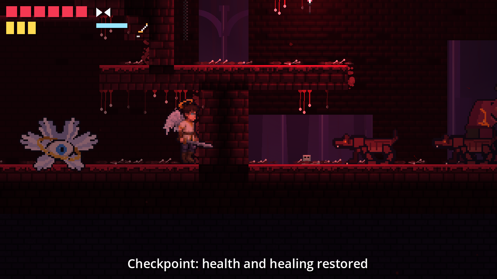
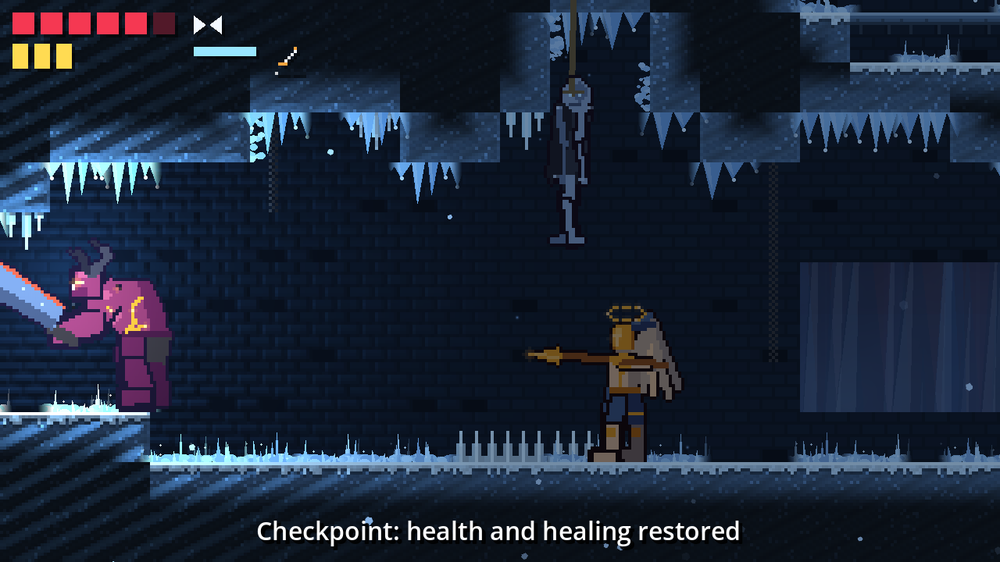
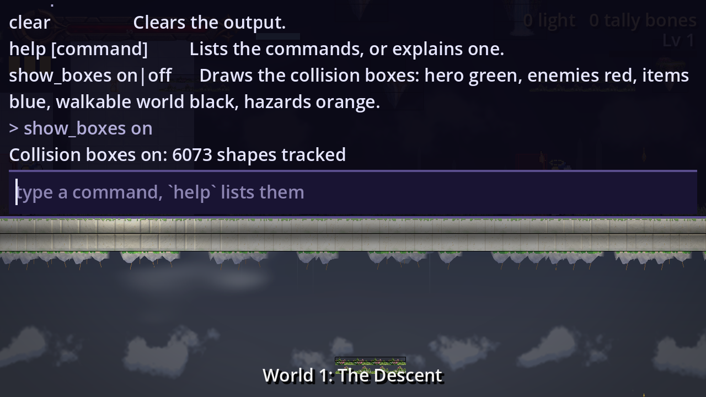
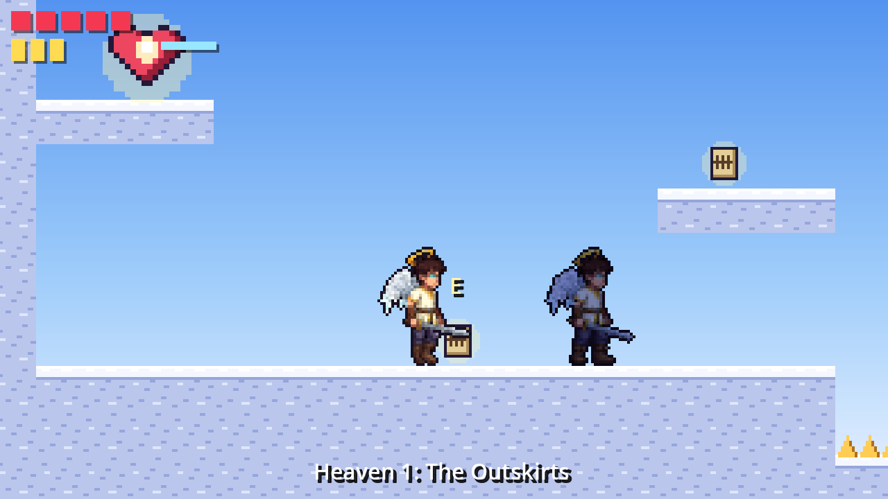

# Descender

A side-view metroidvania built in Unity 6 (URP, 2D Renderer, 320 x 180):
Ansel, a man with half-finished angel powers, fights his way down from
Heaven, through Purgatory and the nine circles of Hell, to rescue his
brother.

This repository holds the game as a Unity project at its root (`Assets/`,
`Packages/`, `ProjectSettings/`): the whole world as one connected map,
the hero, movement, melee combat, enemies, checkpoints, limited healing
and the story's first scenes, behind a title screen with three save slots.
The design lives in `docs/design/`, the story in `docs/story/`, and how the
code is put together in [`docs/ARCHITECTURE.md`](docs/ARCHITECTURE.md).
The game began as a Godot 4 prototype; that project is in history at the
tag `godot-last` and nothing here reads from it.

## Running it

1. Install Unity Hub and, through it, the editor version named in
   `ProjectSettings/ProjectVersion.txt` (6000.6.8f1).
2. Open the repository root as a project and press **Play**.

`Descender > Play from Main scene` (ticked by default) makes Play load
`Assets/Scenes/Main.unity`, the scene with the game systems, whatever
scene is open, so a fresh checkout's empty scene does not show a bare blue
screen. Main boots to the title menu; New Game enters the world. Untick the
menu item to play exactly the scene that is open, or use `Descender > Play
from here` (Alt+P) to drop the hero at the centre of the Scene view in a
region or zone scene, with every ability unlocked; `Play from here (no
abilities)` drops him bare.

The game renders at **320 x 180** and scales up by whole numbers (a Pixel
Perfect Camera), so the window is 1280 x 720 by default and full screen
fills the display at the screen's own aspect. Physics runs in `FixedUpdate`
at 60 ticks a second; input is read every frame and buffered.

## Controls

The bindings are in `Assets/Settings/Descender.inputactions` (Player and UI
maps, Keyboard and Gamepad schemes).

| Action | Keyboard | Gamepad |
| --- | --- | --- |
| Move | A / D or arrows | Left stick / D-pad |
| Drop | S or Down, with jump | Stick or D-pad down, with A |
| Jump | Space, W or Up | A |
| Attack | J or X | X |
| Dash | K or Shift | RB or B |
| Cast | L or C | RT |
| Heal | H | Y |
| Talk | E | LB |
| Menu pages | Q / E | LB / RB |
| Pause | Esc | Start |
| Restart | R | |
| Console | ` | |

The title screen is driven with the arrow keys, the d-pad or the left
stick, Space or A to choose and Esc or B to go back; every menu works the
same way with a gamepad alone.

**Button prompts** follow whatever the player last touched: press a key and
the hints along the bottom of the menus, the HUD messages and the talk
prompt over an NPC name keys; press a gamepad button and they turn into
button icons, in the Xbox layout or the PlayStation one depending on the
pad's name. The **Button prompts** setting on the Game page pins one layout
(Auto, Xbox, PlayStation). A hint is text with `{action}` tokens that
`Prompts` redraws on every switch; the icons under `Assets/Art/UI/Prompts`
are drawn by `tools/gen_prompts.py`.

**New Game** picks a slot (an occupied one asks to be pressed twice before
it is overwritten), **Continue** resumes the most recent save and **Load
Game** picks any slot. A new game then picks a **difficulty**, kept with the
save: Easy gives the hero an extra heart and an extra healing charge, Hard
makes every blow on him land twice as hard, and Normal is the descent as it
was meant. **Credits** lists who made the game, and the version in the
corner is the project's version (`Application.version`).

**Settings**, on the title screen and in the pause menu, has four pages.
**Audio**: the master, music and sound effect volumes and a toggle for the
blips dialogue ticks with. **Display**: fullscreen, the window size, v-sync
and the screen shake. **Controls**: the bindings, rebound separately for
keyboard and gamepad (pick an action, press the new key; a key taken from
another action is moved, not shared; Esc keeps the old one). **Game**: the
dialogue text speed, toggles for the hit flashes, the hit pause and gamepad
rumble, and the button prompts layout. Settings are `settings.json` under
`Application.persistentDataPath`.

Pausing opens a menu to resume, restart at the last checkpoint (what R
does), save, open the map, read the promises (the quest log), open the pack
(the inventory), open the settings or quit to the title, which asks to be
pressed twice since whatever happened after the last save goes with it.

The top left of the screen shows hearts, healing charges, the angel
abilities unlocked so far and a small bar that fills as the dash comes
back; the top right shows the purse (light and tally bones). Jump height
depends on how long the button is held. Dashing gives a few invulnerability
frames. Picking up the feather unlocks the **wings**: press jump again in
the air for a second, slightly lower jump. The second feather unlocks the
**light dash**: the dash goes further and passes through walls of angel
light, which block everyone else. Deeper down, the **wall grip** feather
lets the hero cling to a wall by holding towards it, sliding slowly, and
spring away from it with jump; the **glide** feather lets him press jump
again while falling, once the wings' jump is spent, and hold it to float
down. **Holy Light** throws a bolt of light from the hand with the cast
key. **Smite** is down and attack in the air: the hero slams to the ground,
through any ledge in the way, and the landing hurts everything around his
feet. Abilities stay unlocked after death.

Healing has three charges that come back when the hero rests at a
checkpoint, which is also where he respawns after dying. Resting at a
checkpoint saves the game: the region, the checkpoint, the unlocked
abilities, the story flags, the pack, the skills and the time played go to
the slot the game was started from, as `slot_<n>.json` under
`Application.persistentDataPath/saves`. Pressing talk at a checkpoint the
hero has rested at **makes camp**: a menu over the paused game with the
pack, the **skills** (a few ranks each, bought with the point every level
of experience after the first gives) and fast travel to another checkpoint he has rested
at. Thin ledges can be jumped up through from below, and the hero drops
through one by holding down and pressing jump.

The world's **locked doors** are seals of angel light across the shafts
and doorways between rooms. A seal lifted by an ability breaks the moment
the hero learns it; one held by a boss breaks when that boss dies. Every
boss room holds a **boss** (`Assets/Data/Bosses`): walking in seals the
room's doors, plays the boss's lines and shows its health bar. The boss
walks at the hero, swings with a wide telegraphed sweep and charges across
the room when he keeps away; each body has a move of its own on top, and at
half health it quickens. Killing it sets a story flag (`boss:<id>`), saves
the game, opens the doors it held and plays its last lines; a dead boss
stays dead in the save.

Hidden in the regions are **permanent upgrades** (a Kept Light adds a
heart, a Vial of the Basin a healing charge) and timed **power-ups** (a
Halo turns the next hit aside, a Lit Blade makes the sword hit harder, Zeal
makes the hero run and dash faster, each for twenty seconds); the design is
in [`docs/design/upgrades.md`](docs/design/upgrades.md). Spikes cost one
heart and put the hero back on the last solid ground. Enemies swing when
the hero stands close: they stop, glow orange while winding up, then strike
and pause to recover; hitting one during the wind-up cancels the swing
(except a brute's). A killed one stops time for a blink, dies in its own
way and sometimes leaves a mote of light that restores a heart. Every kill
leaks **light**, the common currency, and now and then a **tally bone** or
a Basin Flask, and gives **experience**. Each enemy body is a prefab
variant under `Assets/Prefabs/Enemies` wearing a profile from
`Assets/Data/Enemies` (size, speed, health, the swing, the drops) and the
animation strips under `Assets/Art/Sprites/<name>`; the roster, with every
body's numbers and where it stands, is in
[`docs/design/enemies.md`](docs/design/enemies.md). The economy (Old Pell's
forge, Vael the Bargainer, the pack, the bosses' unique loot) is in
[`docs/design/economy.md`](docs/design/economy.md) and the levels and
skills in [`docs/design/progression.md`](docs/design/progression.md).





The story is told in text boxes. Standing next to someone, or to a relic,
shows the talk key above them; pressing it opens a box at the bottom of the
screen, and the same key (or jump) turns the page. The text types out with
a soft blip, pitched by who is speaking; the speaker's name takes their
colour; the hero stands still and cannot be hurt while a box is open.
People say different things once the hero has heard their first lines,
relics are gone once read, and a few spots speak on their own the first
time the hero walks through. What he has seen is kept as story flags in the
save. The lines are `Assets/Data/dialogue/world_1.json`, entries keyed by
id with their `lines`, the flags they `set`, `unless` and `requires`
guards, `then` chains and `choices`; the script for the whole game is
[`docs/story/script.md`](docs/story/script.md). The pause menu's
**Promises** page lists every side quest the hero has taken on with its
steps ticked (`Quests` names the flags).

## Developer console

The grave key (`` ` ``, under Escape) opens a console over the top of the
screen for debugging and playtesting; the same key or Escape closes it.
The game stands still while it is open. Type a command and press Enter; the
up and down arrows walk back through earlier lines.

| Command | What it does |
| --- | --- |
| `help [command]` | Lists the commands, or explains one |
| `clear` | Clears the output |
| `show_boxes on` | Draws every collider over the game: the hero green, enemies red, items and triggers blue, the walkable world black, hazards orange |
| `show_boxes off` | Takes the boxes away (`show_boxes` alone says whether they are on) |



Commands live in a registry (`DevConsole.Commands`) so any script can add
one: `Commands.Register(name, handler, usage, help)`. The handler takes the
words typed after the name and returns the text to print; a line that
starts with `Usage:` flags a bad argument.

## The world

The world is one grid of horizontal bands, 480 tiles wide, stacked top to
bottom: Paradise, Ruined Earth, Purgatory and the nine circles from Limbo
to Treachery, each with an ambient colour that tints the screen while the
hero is in it. `Assets/Data/World.asset` (a `WorldAtlas`) lists the bands,
where a new game starts and every checkpoint in save order; an EditMode
test checks that the bands are contiguous and that every placement sits
inside its band.

Each region is a scene, `Assets/Scenes/Region_<key>.unity`, loaded
additively. `WorldStreamer` in `Main.unity` keeps the hero's band and its
neighbours loaded and unloads the rest, so he walks or falls from one into
the next. A region scene holds its `RegionRoot`, the tilemaps (`RegionTiles`
builds the Background, Decor, Terrain and Glow layers and their colliders
at load from the region's `RegionTileSet` under `Assets/Data/Regions/Tiles`),
its lights, rooms and doors, backdrop layers, particles, props and
`WorldPlacement`s: the start, the checkpoints, the feathers, the upgrades
and power-ups, the enemies (a boss where the placement names one), the
NPCs, the relics and the story triggers. Placements spawn their prefabs
through the `PlacementCatalog` (`Assets/Data/Placements.asset`) unless a
story flag or the kill tracker says the thing is gone. The twelve
prototype region scenes are hand-owned Unity assets, edited in the editor
like any other scene.



**Paradise is being rebuilt** to production quality as the first region
of the roadmap (`docs/design/paradise.md`, `docs/delivery/STATE.md`). It
lives under `Assets/Scenes/Paradise/`: `ParadiseMain.unity` and one scene
per zone, declared in `ParadiseLayout` and built by the `Descender >
Paradise` menu: `Build new zones` makes the scenes a layout names and no
scene exists for, `Rebuild zone N from layout` redoes one (and loses hand
edits), `Sync placements from layout` adds or moves the story beats by id
in an existing scene and touches nothing else, `Sync world from scenes`
refreshes `Assets/Data/Paradise/ParadiseWorld.asset`, `Create zone looks`
and `Build hero rig` make the rest. `ParadiseChecker` is an EditMode test
that walks each zone's main path against the construction rules of the
design (gaps, steps, falls, shrine spacing). `Descender > World > Build
region tiles` previews a prototype region's tiles in the editor.

## Layout

| Path | What it is |
| --- | --- |
| `Assets/Scenes/Main.unity` | The persistent scene: camera, HUD and menus, audio, input, `GameFlow`, `WorldStreamer`, the fade. `Descender > Setup > Main scene` rebuilds its wiring |
| `Assets/Scenes/Region_<key>.unity` | The twelve prototype regions |
| `Assets/Scenes/Paradise/` | The rebuilt Paradise: `ParadiseMain.unity` and the zone scenes |
| `Assets/Scripts/Runtime/` | `Descender.Runtime`: one folder per area (`Game`, `Player`, `Enemies`, `Combat`, `Pickups`, `World`, `Story`, `Economy`, `Save`, `UI`, `Input`, `Audio`, `Camera`, `Fx`); the map is in `docs/ARCHITECTURE.md` |
| `Assets/Scripts/Editor/` | `Descender.Editor`: the `Descender >` menu (`Setup/`, `Importers/`, `World/`, `Paradise/`, `Build/`) |
| `Assets/Tests/EditMode/`, `Assets/Tests/PlayMode/` | The two test assemblies (below) |
| `Assets/Prefabs/` | `Player.prefab`, `Enemies/`, `Pickups/`, `Props/<key>/`, `Paradise/` |
| `Assets/Data/` | The ScriptableObjects: `Enemies/`, `Bosses/`, `Regions/` (looks and tiles), `World.asset`, `PlayerTuning.asset`, `Placements*.asset`, `SfxLibrary.asset`, `Paradise/`; `dialogue/world_1.json` |
| `Assets/Art/` | `Sprites/` (character strips, `sprites.json` and the standalone pickups), `Tiles/`, `Props/`, `Regions/` (painted backdrops), `UI/` (theme, prompts), `Fonts/` (Pirata One, OFL), `Paradise/` |
| `Assets/Audio/` | `sfx/`, `music/` and the two ambient loops |
| `Assets/Settings/` | The URP asset and 2D Renderer, `Descender.inputactions`, `Materials/`, `Post/`, `MenuTheme.asset` |
| `Assets/Shaders/` | The sprite flash and glow shaders and the Paradise shader graphs |
| `Assets/Resources/UiTheme.asset` | The one `Resources.Load`: the stone theme of the menus |
| `tools/hooks/pre-push` | Runs the Unity tests before a push (Tests) |
| `tools/unity/build_prefabs.py` | Writes the hero, enemy and pickup prefabs and the small data assets they reference as Unity YAML with path-derived GUIDs, so a session without an editor keeps them in step with the code; deterministic, CI checks its output matches |
| `tools/unity/unity_meta.py` | The shared helpers: `.meta` writers with path-derived GUIDs, sprite slicing from `sprites.json`, `write_metas` and `ensure_meta` |
| `tools/unity/check_tools.py` | The regression guard CI runs: every `tools/` module imports and names no Godot path |
| `tools/gen_sounds.py`, `tools/gen_music.py` | Synthesise the placeholder effects and the music loops (Sounds) |
| `tools/gen_prompts.py`, `tools/menu_textures.py`, `tools/gen_placeholders.py` | Draw the button prompts, the menu theme's textures and the checkpoint, gate, feather, barrier, relic, upgrade and power-up sprites |
| `tools/enemy_sprites/`, `tools/npc_sprites/` | The pixel rigs and their `export.py`, which draw the enemy and NPC strips into `Assets/Art/Sprites/<name>/` and update `sprites.json` |
| `tools/hero_placeholder/gen.py`, `tools/hero_cutout/` | The stand-in hero's strips (every frame fitted to his 14 x 32 collision box; `--sheet out.png` draws the box over each frame) and the painted hero's cut-out rig and `export.py` |
| `tools/paradise_art/`, `tools/ai_art/` | The Paradise art generators and the key-art pipeline, writing under `Assets/Art/Paradise/` |
| `docs/` | `ARCHITECTURE.md`, `design/`, `story/`, `delivery/STATE.md` (the roadmap, backlog and how work is verified), `screenshots/` (prototype screenshots) |
| `.claude/skills/` | The per-topic rules an agent reads before touching an area |

Every generator takes `--out` (default: its Unity folder), writes a `.meta`
for a new file under `Assets/` and never overwrites an existing one; they
need Python 3 with Pillow (and numpy for the sound, music and cut-out
scripts). The committed art and audio are the source; the scripts are run
to change a recipe, not on every build.

## Tests

Two test assemblies under `Assets/Tests`: **EditMode**
(`Descender.Tests.EditMode`: data, static state, save round trips, the
dialogue file, the placement catalog, the Paradise layout and its checker,
the repository itself; anything without a scene) and **PlayMode**
(`Descender.Tests.PlayMode`: a floor made in code, the hero and an imp
stepped through `FixedUpdate`, the dialogue flow; few and broad). They run
from the editor's Test Runner, or from the pre-push hook, which refuses a
push when they fail. Install the hook once per clone:

```
git config core.hooksPath tools/hooks
```

The hook finds the editor named in `ProjectSettings/ProjectVersion.txt`
under the Unity Hub folder (or at `UNITY_EDITOR`), runs both platforms in
one editor launch and prints its phase, the elapsed time and the summary
lines (`pre-push: EditMode passed (N tests).`). It refuses to run while
the project is open in the editor. Without the hook, the same run is

```
Unity -batchmode -projectPath . -executeMethod Descender.EditorTools.Build.PrePushTests.Run -prePushResults Logs
```

CI (`.github/workflows/tests.yml`) runs on every pull request and push to
`main` without a Unity licence: `csharpier check Assets` (CSharpier 1.0.3,
120 columns) and the Python tools job (`python3 -I
tools/unity/check_tools.py`, then `build_prefabs.py` with `git diff
--exit-code`). The Unity tests run on a developer machine through the
hook; a pull request says so with the hook's summary lines. See
`docs/delivery/STATE.md` for how work is verified and
`.claude/skills/unity-testing-and-ci`.

## Releases

Pushing a tag that starts with `v` builds the game and publishes it on the
repository's Releases page:

```
git tag v0.4.0
git push origin v0.4.0
```

`.github/workflows/release.yml` builds Linux and Windows through GameCI
(`game-ci/unity-builder`, which needs the `UNITY_LICENSE`, `UNITY_EMAIL`
and `UNITY_PASSWORD` secrets), zips each build and attaches both to a
GitHub release named after the tag, with notes generated from the merged
pull requests. Nothing is built on an ordinary push or merge; only a tag
releases, and tagging needs the project owner. `Descender > Build >
Windows (new Paradise)` makes a local Windows build of the rebuilt
Paradise from the editor.

## Sounds

Every sound under `Assets/Audio/sfx` is a synthesised placeholder. To
change one, edit its recipe in `tools/gen_sounds.py` and run
`python3 tools/gen_sounds.py` (needs numpy). Effects are played by name
through `Sfx` and the `SfxLibrary` asset (`Assets/Data/SfxLibrary.asset`,
one entry per clip, written by `build_prefabs.py`), so a real recording
only has to keep the file name.

The music is made the same way by `tools/gen_music.py`: one loop per
region under `Assets/Audio/music/`, named by the region's key (`paradise`,
`ruined_earth`, `purgatory`, `limbo` ... `treachery`), plus `title` for the
title screen and `boss` for the fights. Each is a short composition for a
tiny sequencer whose tails wrap round the loop's end so it joins without a
click. The script encodes to Ogg Vorbis with ffmpeg when it is installed
and leaves WAV otherwise; the game loads either. Crossing into a region
crossfades to its loop (`Music`), a boss fight takes over until it ends,
and the pause menu ducks the music. The Audio page's sliders set the
master, music and effect volumes.

## Pull request reviews

Every pull request gets an automatic review from Claude Code (see
`.github/workflows/claude-code-review.yml`). The full review runs when a PR
is opened, reopened or marked ready for review; drafts are skipped. Later
pushes get a short follow-up that looks only at the new commits and reports
blocking bugs only. What the reviewer checks, skips and how many nits it
may post is set in [`REVIEW.md`](REVIEW.md); the delivery rules for agents
are in [`CLAUDE.md`](CLAUDE.md).
