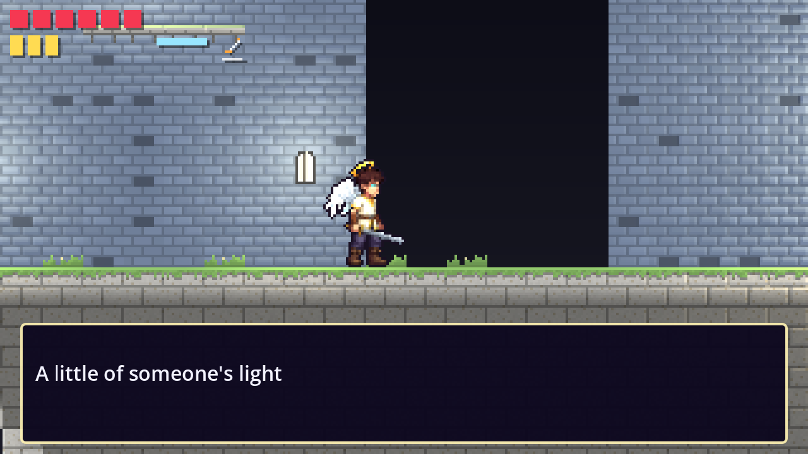
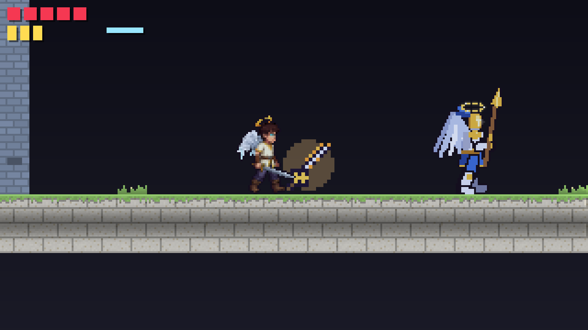

# Descender: upgrades and power-ups

Written 2026-10-20 against `main` after PR #49 (dialogue system). Section 1
is the design: what kinds of upgrades the game has, how each works and how
many it needs. Section 2 is what is in the game now (the first set, placed
in the two Heaven levels). Section 3 is how the pieces are built, for the
level issues.

The names use the story draft (`docs/story/script.md`): the hero is Ansel,
the angels are made from gathered people in the Basin, and "light" is what
they are made of. Every pickup name and description follows that: an upgrade
is never a generic potion, it is a piece of the farm Ansel is climbing out
of.

---

## 1. Design

### Three layers

Descender already has one layer of progression: the six **angel abilities**
(wings, light dash, light bolt, glide, seal break, true sight), one per
area, each opening a gate type. Those are the Metroidvania keys and they
stay as they are (#12 decides where each one lives).

This doc adds the two layers around them:

| Layer | What it is | Kept? | Why it exists |
| --- | --- | --- | --- |
| **Abilities** | New verbs. Open the world. | For the run, saved | The spine of the game |
| **Upgrades** | Permanent numbers: more hearts, more healing, a harder sword | Saved, never lost | Reward exploring and backtracking; make the player stronger over 13 areas |
| **Power-ups** | Timed buffs picked up in a room | Lost on death, not saved | Change one fight; give a level designer a dial per room |

Rules that hold for all of them:

- **Nothing is bought with a currency.** The game has no coins and does
  not need them. The blacksmith's upgrades cost a found item (church iron),
  the Bargainer's cost a memory (a story flag). Everything else is picked up.
- **Every pickup is visible before it is reachable.** An upgrade behind a
  wall of light or on a high ledge is shown to the player first, so the
  later ability has a known reward waiting.
- **Pickups never respawn, power-ups always do.** A collected upgrade is a
  story flag (`upgrade:<kind>:<level>:<n>`), skipped on load. A power-up
  placed in a room comes back with the enemies when the hero respawns, so a
  checkpoint run always faces the same fight with the same tools.
- **Descriptions use the dialogue box.** A permanent upgrade opens the text
  box with two lines (what it is, what it does), like a relic. A power-up
  only shows the one-line HUD message, because it is picked up mid-fight.

### Permanent upgrades

| Upgrade | Effect | Start | End | Count | Found |
| --- | --- | --- | --- | --- | --- |
| **Kept Light** | +1 max heart, and fills them | 5 hearts | 10 hearts | **5** | One hidden per area pair: Heaven 1, Purgatory, Earth, circles 3 to 4, circles 7 to 8 |
| **Vial of the Basin** | +1 healing charge, and refills them | 3 charges | 5 charges | **2** | Heaven 2, circle 5 |
| **Church Iron** | Taken to Old Pell on Earth: +1 sword damage per piece | 1 damage | 3 damage | **2** | Earth (the first, Pell's own stock), circle 6 |

Nine permanent pickups plus the six abilities make fifteen across thirteen
areas (Heaven 1 and 2, Purgatory, Earth, nine circles): about one per area,
which is what a four-to-six hour Metroidvania wants. Hearts and vials are
hidden and optional; a player who finds none finishes the game at 5 hearts,
which the boss tuning should allow. The sword tiers are on the main path in
spirit (the first piece is given by Pell) but can be missed.

Why these numbers:

- **Hearts 5 to 10.** Doubling health over the game is the usual curve
  (Hollow Knight 5 to 9, Ori 3 to 12). Five pickups spaced one per two to
  three areas means the player finds one every forty minutes or so.
- **Healing 3 to 5.** Healing is already strong (2 hearts per charge, full
  refill at checkpoints). Two upgrades is enough; more would make the
  checkpoints meaningless.
- **Damage 1 to 3.** Enemies take 1 to 4 hits now. A tier at Earth (the
  midpoint) and one at circle 6 keep the hit counts similar as enemy health
  rises in Hell, without making Heaven enemies one-shots on a replay.

What is deliberately **not** an upgrade: run speed, jump height, dash
distance. Those are the hero's body and the abilities change them; a
numbers upgrade on top would make every jump in the level design uncertain.

### Power-ups

Timed, 20 seconds each (the Halo lasts until it is spent), one of each kind
at a time (picking a second one restarts the timer), all lost on death and
at the end of the level.

| Power-up | Effect | Shown as | Lore |
| --- | --- | --- | --- |
| **Mote of light** (already in the game) | +1 heart | A pulsing dot | What leaks out of a killed angel or imp |
| **Halo** | The next hit is turned aside: no damage, no knockback. Spikes still put the hero back on solid ground. | A ring over the hero's head in the HUD | A Warden's halo, cracked; it still remembers how to protect |
| **Lit Blade** | +1 sword damage for 20 s | Gold sword icon with a draining bar; the swing tints gold | Choir fire on the edge of the blade |
| **Zeal** | Dash cooldown 0.4 s to 0.15 s and run speed +25% for 20 s | Blue chevrons with a draining bar | The hurry the Making put in him |

Three new kinds is the right number for the first pass. Each one maps to
one of the hero's three verbs (take a hit, swing, move) so a designer can
tune a room by placing one: a Halo before a guard that hits hard, a Lit
Blade before a crowd, Zeal before a long run with watchers. More kinds
(a light shield that reflects, a slow-time bell) can come when the circles
need them; they do not need new systems, only a new `Power` entry.

Sources, in order of when they arrive:

1. **Placed in rooms** (this PR). The level designer puts them where a
   fight wants a hint.
2. **Dropped by enemies** (next). Imps and guards get a small chance to drop
   one instead of a mote; brutes always drop a Halo. Keeps longer fights
   interesting without more placements.
3. **Sold by Vael** (circles 3, 6, 8). Vael's shop sells power-ups for a
   memory: each purchase sets a flag that removes one of Ansel's lines later
   (he no longer remembers the song, the tally, his brother's face). The
   player can buy strength at the cost of the story they are reading.

### Where the first set goes, and the gating language

Every hidden upgrade is reached with the ability the player has just
learned, so the first thing the new ability does is pay out:

| Place | Pickup | Needs | How the player sees it |
| --- | --- | --- | --- |
| Heaven 1, ledge above the start | Kept Light | Wings | Visible from the first screen, six tiles up: two more than a jump, well within a double jump. After the feather, the way back is short. |
| Heaven 1, upper platform mid-level | Halo | A jump | The first power-up, on the climb the player makes anyway |
| Heaven 1, before the guard at the wall of light | Lit Blade | Nothing | A hint: the guard takes two hits; with the blade, one |
| Heaven 2, ledge in the top-left corner | Vial of the Basin | Wings | Visible from the start of the level, in the corner the path turns away from |
| Heaven 2, right after the wall of light | Zeal | Light dash | The reward for getting through: the run to the gate with the guard and the imp becomes a sprint |

Later areas follow the same rule: the Purgatory heart is behind a light
wall, the Earth heart is up an updraft (glide), the circle 5 vial is behind
a seal, and so on. Each gate type keeps the look #12 gives it; an upgrade
behind it only needs to be in sight.

### HUD

Hearts grow to the right as they are gained (ten fit before the ability
icons, which move over). Power-ups show as small icons after the abilities,
each with a one-pixel bar that drains as its time runs out. The Halo has no
bar; it goes when it is spent.

---

## 2. In the game now

Five placements in the two Heaven levels, as listed above. The first
images:

| Sprite | Name | Description shown in the game |
| --- | --- | --- |
|  | Kept Light | *A little of someone's light, kept back from the Basin before it could be pressed. It is warm, and it does not ask whose it was.* Hearts: 6. |
|  | Vial of the Basin | *Basin water in Warden's glass. The gathered drink it on the way in so they do not struggle. In him it only closes wounds.* Healing charges: 4. |
|  | Halo | *Halo: the next hit is turned aside* |
|  | Lit Blade | *Lit Blade: the sword hits harder for a while* |
|  | Zeal | *Zeal: faster dashes and feet for a while* |

The sprites are 16x16 placeholders in the style of the feather and the
relic, drawn by `tools/gen_placeholders.py` and shown at twice their size in
the level. Previews at six times their size are in the project folder under
`upgrades/`.

---

## 3. How it is built

- `scripts/upgrade.gd` (`Upgrade`): an `Area2D` placed as an `upgrade`
  object (`heart` or `vial`) in `levels/world/placements.json`. Touching it calls
  `Player.apply_upgrade`, which raises the maximum and fills it, sets the
  flag `upgrade:<kind>:<level>:<n>` (n counts that kind's pickups in
  placement order) and frees the node. The level builder skips flagged pickups when
  it builds, so a loaded save does not show them again. On boot,
  `Player.restore_upgrades` counts the flags and sets the maximums, so a
  loaded hero keeps his hearts in any level.
- `scripts/power_up.gd` (`PowerUp`): an `Area2D` placed with `O` (Halo),
  `B` (Lit Blade) or `Z` (Zeal). Touching it calls `Player.grant_power`.
  The builder remembers where they were and `spawn_power_ups` puts them
  back when the enemies respawn.
- `Player.powers` is a dictionary from `Power` to seconds left (`INF` for
  the Halo). `attack_damage()`, `dash_cooldown()` and `run_speed()` read
  it; `take_damage` and `take_hazard_damage` ask `_spend_halo()` first.
  Everything is cleared on death.
- `max_health` and `max_heal_charges` are now variables on the player;
  `MAX_HEALTH` and `MAX_HEAL_CHARGES` are the base values a new game
  starts with.
- The HUD's `StatusBar` draws the hearts from `max_health`, moves the
  ability icons past them, and draws the power-up icons with their timers.
- Descriptions live in `Upgrade.DESCRIPTIONS` and `PowerUp.MESSAGES`, so a
  pickup reads the same in every level. `main.gd` plays an upgrade's lines
  through the dialogue box (the hero stands still, as for a relic) and a
  power-up's line as a HUD message.
- Church iron, Old Pell's forge and Vael's shop are not built yet. Pell's
  forge needs the Earth hub (the story thread's next PR); the iron pickup
  can reuse `Upgrade` with a third kind that sets a flag and changes
  nothing until Pell reads it.
